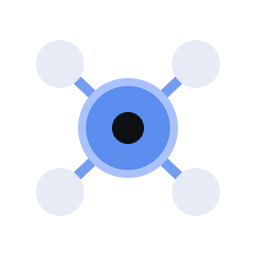
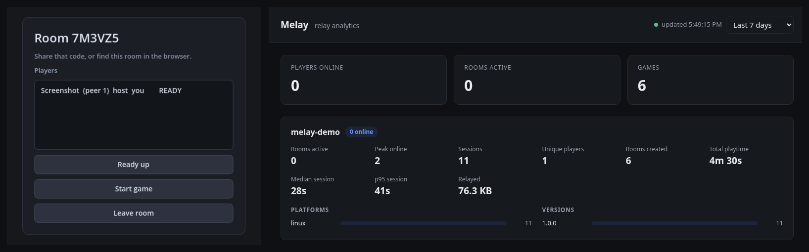
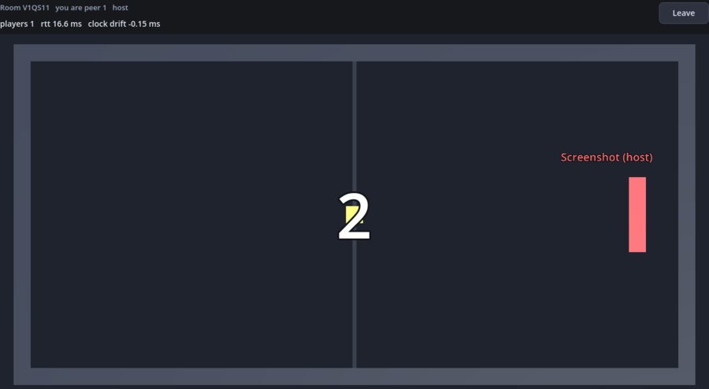

<div align="center">



# Melay

**Cross platform multiplayer for Godot 4.**

Steam · PC · Mobile · Browser. One codebase, no native build step.

[Documentation](https://bearlikelion.github.io/melay/) ·
[Quick start](https://bearlikelion.github.io/melay/quickstart) ·
[Hosting](https://bearlikelion.github.io/melay/hosting) ·
[Reference](https://bearlikelion.github.io/melay/reference)



</div>

---

Melay is two pieces:

- **An addon** that gives you a Godot `MultiplayerPeer`, so your `@rpc` functions work unchanged.
- **A relay** you run in Docker, which passes packets between players on any platform.

Because it is pure GDScript over WebSocket, the same build talks to the same players everywhere.
A phone, a browser tab and a Steam copy can all sit in the same room.

```gdscript
Melay.configure("wss://your-relay", "my-game", "1.0.0")
await Melay.connect_to_relay()

var result: MelayResult = await Melay.create_room({"max_players": 4})
print("Share this code: ", result.value.code)
```

Another player calls `Melay.join_room(code)` and you are connected.

## Get started

```bash
docker run -d -p 8890:8890 -v melay-data:/data ghcr.io/bearlikelion/melay:latest
```

Then drop `addons/melay/` into your project and enable it in *Project Settings > Plugins*.

**[Full quick start](https://bearlikelion.github.io/melay/quickstart)** walks through hosting,
joining, lobbies and starting a match.

## What you get

Rooms with share codes · a public room list · per game analytics · a clock every player agrees
on · packets too large for one frame split and rebuilt for you · version safety so old builds
cannot join new ones.

## What it is not

Melay passes packets. It does not run your game and does not check what players send. One
player hosts, and everyone trusts them.

## Try it

`demo/` is a complete Godot project with a menu, a lobby and a small 3D arena. Start a relay,
open it in Godot and press F5.

<div align="center">

</div>

## Licence

MIT. See [LICENSE](LICENSE).
